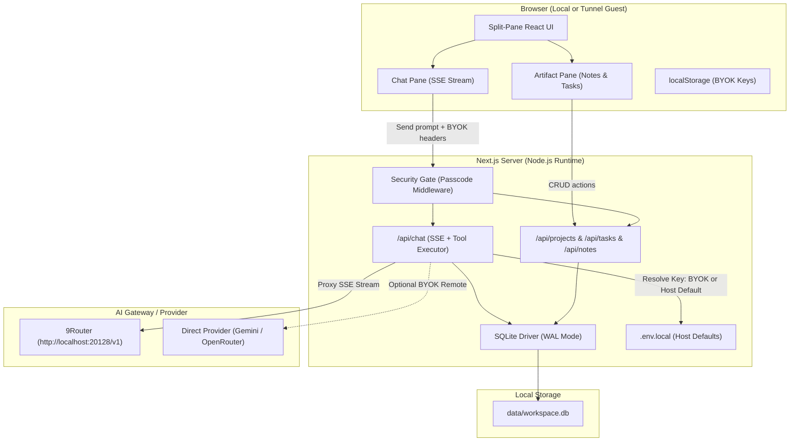

# Architecture Specification

## Project: Interactive AI Project Workspace

- **Document Version:** 1.0.0
- **Status:** Approved Architecture Blueprint

---

## 1. System Architecture Overview

The system operates as a **Local-First Full-Stack Application** built on Next.js App Router with an embedded SQLite database and a streaming AI pipeline.



---

## 2. Directory Layout

```text
Interactive_AI_Workspace/
├── .agents/skills/              # Matt Pocock Engineering Skills
├── data/                        # Local SQLite Database (Gitignored)
│   └── workspace.db
├── docs/                        # Specifications & Blueprints
│   ├── PRD.md
│   ├── ARCHITECTURE.md
│   └── TASKS.md
├── src/
│   ├── app/                     # Next.js App Router
│   │   ├── api/
│   │   │   ├── auth/verify/     # Passcode verification endpoint
│   │   │   ├── chat/            # Streaming AI + Tool Calling
│   │   │   ├── projects/        # Project CRUD
│   │   │   ├── tasks/           # Task Checklist CRUD & reorder
│   │   │   └── notes/           # Note CRUD & update
│   │   ├── layout.tsx
│   │   ├── page.tsx             # Main Split-Pane Workspace
│   │   └── globals.css
│   ├── components/              # UI Components
│   │   ├── chat/                # Chat messages, input, tool cards
│   │   ├── artifacts/           # Markdown editor, task checklist
│   │   ├── modals/              # Settings modal (BYOK), Passcode modal
│   │   └── ui/                  # Buttons, badges, toasts
│   ├── lib/                     # Core Business Logic & Infrastructure
│   │   ├── db/
│   │   │   ├── schema.sql       # Database schema
│   │   │   └── client.ts        # SQLite connection + WAL config
│   │   ├── ai/
│   │   │   ├── tools.ts         # Granular tool definitions & execution
│   │   │   ├── context.ts       # Active notes & tasks prompt injector
│   │   │   └── provider.ts      # BYOK / .env.local resolver
│   │   └── security/
│   │       ├── sanitize.ts      # Markdown XSS sanitization
│   │       └── auth.ts          # Passcode validation helper
├── .env.example
├── .gitignore
├── AGENTS.md
├── package.json
├── tailwind.config.ts
└── tsconfig.json
```

---

## 3. Database Schema (`data/workspace.db`)

All tables use UUIDs or nanoids for primary keys, strict foreign key constraints, and timestamps.

```sql
PRAGMA journal_mode = WAL;
PRAGMA foreign_keys = ON;
PRAGMA busy_timeout = 5000;

-- Projects Table
CREATE TABLE IF NOT EXISTS projects (
    id TEXT PRIMARY KEY,
    name TEXT NOT NULL,
    description TEXT,
    created_at DATETIME DEFAULT CURRENT_TIMESTAMP,
    updated_at DATETIME DEFAULT CURRENT_TIMESTAMP
);

-- Notes Table (One primary note per project in MVP, expandable to multiple)
CREATE TABLE IF NOT EXISTS notes (
    id TEXT PRIMARY KEY,
    project_id TEXT NOT NULL,
    title TEXT NOT NULL DEFAULT 'Project Notes',
    content TEXT NOT NULL DEFAULT '',
    updated_at DATETIME DEFAULT CURRENT_TIMESTAMP,
    FOREIGN KEY (project_id) REFERENCES projects(id) ON DELETE CASCADE
);

-- Tasks / Checklist Table
CREATE TABLE IF NOT EXISTS tasks (
    id TEXT PRIMARY KEY,
    project_id TEXT NOT NULL,
    title TEXT NOT NULL,
    status TEXT NOT NULL DEFAULT 'todo' CHECK (status IN ('todo', 'in_progress', 'done')),
    priority TEXT NOT NULL DEFAULT 'medium' CHECK (priority IN ('low', 'medium', 'high')),
    section TEXT DEFAULT 'General',
    sort_order INTEGER NOT NULL DEFAULT 0,
    created_at DATETIME DEFAULT CURRENT_TIMESTAMP,
    updated_at DATETIME DEFAULT CURRENT_TIMESTAMP,
    FOREIGN KEY (project_id) REFERENCES projects(id) ON DELETE CASCADE
);

-- Chat Messages Table
CREATE TABLE IF NOT EXISTS messages (
    id TEXT PRIMARY KEY,
    project_id TEXT NOT NULL,
    role TEXT NOT NULL CHECK (role IN ('user', 'assistant', 'system', 'tool')),
    content TEXT NOT NULL,
    tool_calls TEXT,      -- JSON-encoded tool calls
    tool_call_id TEXT,    -- For role == 'tool'
    created_at DATETIME DEFAULT CURRENT_TIMESTAMP,
    FOREIGN KEY (project_id) REFERENCES projects(id) ON DELETE CASCADE
);

-- Undo Snapshots Table (Stores pre-mutation state for 1-click reversal)
CREATE TABLE IF NOT EXISTS undo_snapshots (
    id TEXT PRIMARY KEY,
    project_id TEXT NOT NULL,
    message_id TEXT NOT NULL,
    snapshot_type TEXT NOT NULL CHECK (snapshot_type IN ('tasks', 'notes', 'all')),
    state_payload TEXT NOT NULL, -- JSON snapshot of state before mutation
    created_at DATETIME DEFAULT CURRENT_TIMESTAMP,
    FOREIGN KEY (project_id) REFERENCES projects(id) ON DELETE CASCADE
);

-- Indexes for high performance
CREATE INDEX IF NOT EXISTS idx_tasks_project ON tasks(project_id, sort_order);
CREATE INDEX IF NOT EXISTS idx_messages_project ON messages(project_id, created_at);
CREATE INDEX IF NOT EXISTS idx_notes_project ON notes(project_id);
```

---

## 4. API & AI Integration Contracts

### 4.1 AI Provider & BYOK Resolver

In `/api/chat`:

1. Check request headers:
   - `x-ai-base-url`
   - `x-ai-api-key`
   - `x-ai-model`
2. If provided, use these values.
3. If omitted, fall back to server environment variables:
   - `process.env.AI_BASE_URL || "http://localhost:20128/v1"`
   - `process.env.AI_API_KEY || "sk-9router"`
   - `process.env.AI_MODEL || "gemini-2.5-flash"`
4. If neither is available, return `400 Bad Request` with `{ error: "MISSING_AI_CONFIG" }`.

### 4.2 System Context Injection Format

Before dispatching messages to the LLM, the backend constructs the system message:

```text
You are an expert AI software architect and technical co-pilot.
You have direct access to tools to modify the project's task checklist and notes.

=== CURRENT PROJECT STATE ===
[ACTIVE NOTES]:
<Current Note Markdown Content>

[ACTIVE CHECKLIST]:
- [ID: task-1] [x] (high) Initialize repository structure
- [ID: task-2] [ ] (high) Configure SQLite database schema
- [ID: task-3] [ ] (medium) Implement AI tool calling route
=============================

Use tools whenever the user requests creating, updating, checking off, or deleting tasks, or drafting/editing documentation.
```

### 4.3 AI Tool Definitions (JSON Schema)

```typescript
export const workspaceTools = {
  create_task: {
    description: "Add a new task item to the project checklist.",
    parameters: z.object({
      title: z.string().describe("Clear, concise imperative action phrase"),
      priority: z.enum(["low", "medium", "high"]).default("medium"),
      section: z.string().optional().describe("Category or module name")
    })
  },
  toggle_task: {
    description: "Mark a task as completed or uncompleted.",
    parameters: z.object({
      taskId: z.string().describe("The exact ID of the task"),
      isCompleted: z.boolean().describe("true for done, false for todo")
    })
  },
  update_task: {
    description: "Update the title or priority of an existing task.",
    parameters: z.object({
      taskId: z.string().describe("The ID of the task to update"),
      newTitle: z.string().optional(),
      priority: z.enum(["low", "medium", "high"]).optional()
    })
  },
  delete_task: {
    description: "Remove a task from the project checklist.",
    parameters: z.object({
      taskId: z.string().describe("The ID of the task to delete")
    })
  },
  edit_note: {
    description: "Update or append content to the project Markdown notes.",
    parameters: z.object({
      content: z.string().describe("Markdown content to write"),
      mode: z.enum(["replace", "append"]).describe("replace entire note or append section")
    })
  }
};
```

---

## 5. Security & Safety Model

1. **Passcode Protection (`WORKSPACE_PASSCODE`):**
   - If set, incoming requests must include cookie `workspace_session` or header `x-workspace-passcode` matching the hash of `WORKSPACE_PASSCODE`.
   - Protects the host's 9Router/Gemini quota when hosting tunnels via Cloudflare or Ngrok.
2. **Zero Credential Exposure:**
   - Keys received in headers are strictly used in-flight to make the outbound proxy request and never stored in SQLite or server logs.
3. **Strict XSS Protection:**
   - All client Markdown rendering uses:
     ```tsx
     <ReactMarkdown remarkPlugins={[remarkGfm]} rehypePlugins={[rehypeSanitize]}>
       {noteContent}
     </ReactMarkdown>
     ```
4. **Undo Snapshot Engine:**
   - Prior to mutating tasks or notes during tool execution, the server captures `SELECT * FROM tasks WHERE project_id = ?` and `SELECT * FROM notes WHERE project_id = ?`.
   - Saved to `undo_snapshots`.
   - The client UI displays an "Undo" button in the tool-call card. Clicking it sends `POST /api/undo { snapshotId }`, which replaces the current state with the snapshot atomically.
