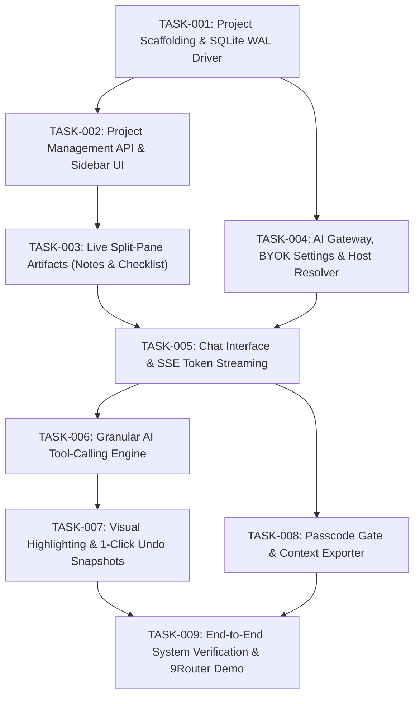

# Implementation Tasks (Backlog & Tracer-Bullet Tickets)

## Project: Interactive AI Project Workspace
- **Architecture Reference:** [ARCHITECTURE.md](file:///D:/Interactive_AI_Workspace/docs/ARCHITECTURE.md)
- **Product Requirements:** [PRD.md](file:///D:/Interactive_AI_Workspace/docs/PRD.md)
- **Status:** Ready for TDD Implementation

---

### Task Dependency Map

---

## Tickets

### [x] TASK-001: Project Scaffolding, Tailwind Setup & SQLite WAL Driver (Completed)
- **Description:** Initialize the Next.js project with TypeScript, Tailwind CSS, and embedded SQLite database driver configured for WAL mode.
- **Blocked By:** None
- **Acceptance Criteria:**
  - [x] `package.json` initialized with Next.js, React 19, TypeScript, Tailwind CSS, and Lucide icons.
  - [x] SQLite connection helper in `src/lib/db/client.ts` initializes `data/workspace.db` with `PRAGMA journal_mode = WAL;`.
  - [x] Database schema in `src/lib/db/schema.sql` creates tables: `projects`, `notes`, `tasks`, `messages`, `undo_snapshots`.
  - [x] `.gitignore` properly excludes `.env.local`, `data/*.db*`, and `node_modules`.
  - [x] A clean `.env.example` is created with placeholder keys.
- **Verification Steps:**
  - Run database initialization script and verify `workspace.db` is created in WAL mode.
  - Run `npm run dev` and verify clean blank layout loads.

---

### [x] TASK-002: Project Management API & Sidebar UI (Completed)
- **Description:** Build end-to-end Project creation, listing, switching, and deletion (vertical slice).
- **Blocked By:** TASK-001
- **Acceptance Criteria:**
  - [x] API routes `GET /api/projects` and `POST /api/projects` with input validation.
  - [x] `DELETE /api/projects/[id]` cascades deletion to notes, tasks, and messages.
  - [x] Default "General" project seeded on first run if no projects exist.
  - [x] Collapsible project sidebar displaying project list, active indicator, "New Project" modal, and delete button.
- **Verification Steps:**
  - Test creating two projects in the UI, switching between them, and verifying active project state updates.

---

### [x] TASK-003: Live Split-Pane Artifacts (Notes & Checklist) (Completed)
- **Description:** Implement the right-side artifact split-pane with tabs for Markdown Notes (live editable & sanitized preview) and interactive Task Checklist.
- **Blocked By:** TASK-002
- **Acceptance Criteria:**
  - [x] API routes `GET/PUT /api/notes` and `GET/POST/PATCH/DELETE /api/tasks`.
  - [x] Tab 1: Markdown Notes editor with live split/preview toggle, sanitized with `rehype-sanitize`. Auto-saves on edit.
  - [x] Tab 2: Task Checklist with priority badges (`low`, `medium`, `high`), status checkboxes, inline title editing, and task deletion.
  - [x] Switching active projects immediately loads the respective project's notes and tasks.
- **Verification Steps:**
  - Create tasks and edit notes manually in the UI; refresh browser and verify persistence from SQLite.

---

### [x] TASK-004: AI Gateway, BYOK Settings & Host Resolver (Completed)
- **Description:** Implement the AI configuration resolver that combines server `.env.local` defaults with client `localStorage` BYOK overrides.
- **Blocked By:** TASK-001
- **Acceptance Criteria:**
  - [x] `src/lib/ai/provider.ts` resolves Base URL, API Key, and Model from request headers first (`x-ai-*`), then server `.env.local`.
  - [x] Settings modal in the UI where users can view host defaults or input custom Base URL, Key, and Model.
  - [x] BYOK credentials persisted in browser `localStorage`.
  - [x] Test button in Settings modal to verify connection to `http://localhost:20128/v1` or configured endpoint.
- **Verification Steps:**
  - Click "Test Connection" in Settings modal; verify successful ping against local 9Router.

---

### [x] TASK-005: Chat Interface & SSE Token Streaming (Completed)
- **Description:** Build the left-pane conversational chat interface with real-time token streaming and automated project context injection.
- **Blocked By:** TASK-003, TASK-004
- **Acceptance Criteria:**
  - [x] Chat UI with message history list, markdown rendering, auto-scrolling, and responsive message input bar.
  - [x] `/api/chat` route streams response tokens via Server-Sent Events (SSE).
  - [x] Active project notes and checklist items are automatically injected into the system prompt context.
  - [x] Chat messages persist in the `messages` table per project.
- **Verification Steps:**
  - Send a prompt in chat; verify smooth streaming output and confirm the AI accurately references the active project notes/tasks.

---

### [x] TASK-006: Granular AI Tool-Calling Engine (Completed)
- **Description:** Implement the native tool-calling pipeline allowing the AI to mutate tasks and notes directly.
- **Blocked By:** TASK-005
- **Acceptance Criteria:**
  - [x] Tools registered in `/api/chat`: `create_task`, `toggle_task`, `update_task`, `delete_task`, `edit_note`.
  - [x] When the AI outputs a tool call, the server executes the SQL mutation, stores the tool execution in message history, and updates the artifact.
  - [x] In the chat UI, tool calls render as clean, expandable status cards (e.g., *"Added task: Setup database schema"*).
- **Verification Steps:**
  - Prompt: *"Add 3 tasks for building our authentication layer and check off the first one"*. Verify tasks appear live in the checklist.

---

### [x] TASK-007: Visual Highlighting & 1-Click Undo Snapshots (Completed)
- **Description:** Add visual diff animations when artifacts mutate and build the 1-click Undo snapshot system.
- **Blocked By:** TASK-006
- **Acceptance Criteria:**
  - [x] Pre-mutation snapshot of tasks and notes saved into `undo_snapshots` before executing any tool batch.
  - [x] Modified tasks and note sections briefly display a highlight flash/pulse in the UI.
  - [x] Tool execution cards in chat feature an **"Undo Changes"** button.
  - [x] Clicking "Undo Changes" posts to `/api/undo`, rolls back the database state, and refreshes the artifact pane immediately.
- **Verification Steps:**
  - [x] Have the AI create or delete tasks; click "Undo" on the chat card; verify previous state is perfectly restored.

---

### [x] TASK-008: Passcode Gate (`WORKSPACE_PASSCODE`) & Context Exporter (Completed)
- **Description:** Implement the optional tunnel security gate and one-click Markdown context/spec exporter.
- **Blocked By:** TASK-005
- **Acceptance Criteria:**
  - [x] If `WORKSPACE_PASSCODE` is set in `.env.local`, unauthenticated visitors are prompted with an unlock modal before API routes allow requests.
  - [x] If `WORKSPACE_PASSCODE` is empty/unset, the gate is disabled and access is immediate.
  - [x] "Export Context" button generates a consolidated, formatted Markdown brief (Project description + Notes + Checklist).
  - [x] User can "Copy to Clipboard" or "Download as .md".
- **Verification Steps:**
  - [x] Set `WORKSPACE_PASSCODE="secret123"`; open an Incognito window; verify passcode prompt blocks access until entered correctly.
  - [x] Test export button and verify clean Markdown output.

---

### [ ] TASK-009: End-to-End System Verification & 9Router Demo
- **Description:** Conduct a complete dogfooding run in Antigravity IDE and OpenCode terminal, verifying full integration.
- **Blocked By:** TASK-007, TASK-008
- **Acceptance Criteria:**
  - [ ] Full automated test suite passes (`npm test`).
  - [ ] TypeScript type-checking passes with zero errors (`npx tsc --noEmit`).
  - [ ] Run app locally connected to `9router` with Gemini, test project creation, live tool calling, undo, and spec export.
  - [ ] OpenCode CLI can query the workspace and inspect artifacts cleanly.
- **Verification Steps:**
  - Complete a live end-to-end feature planning session entirely within the workspace app.

